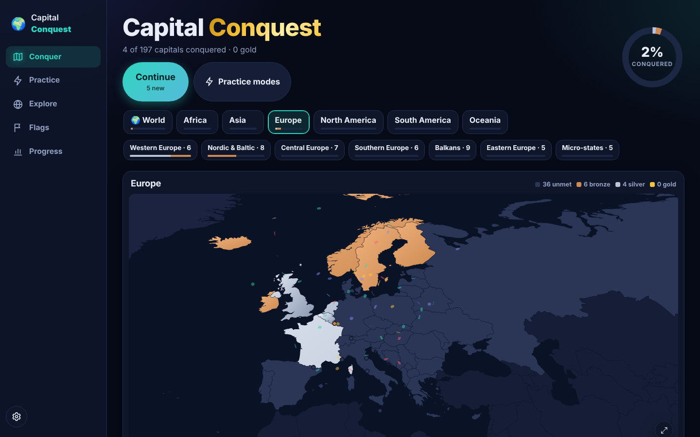
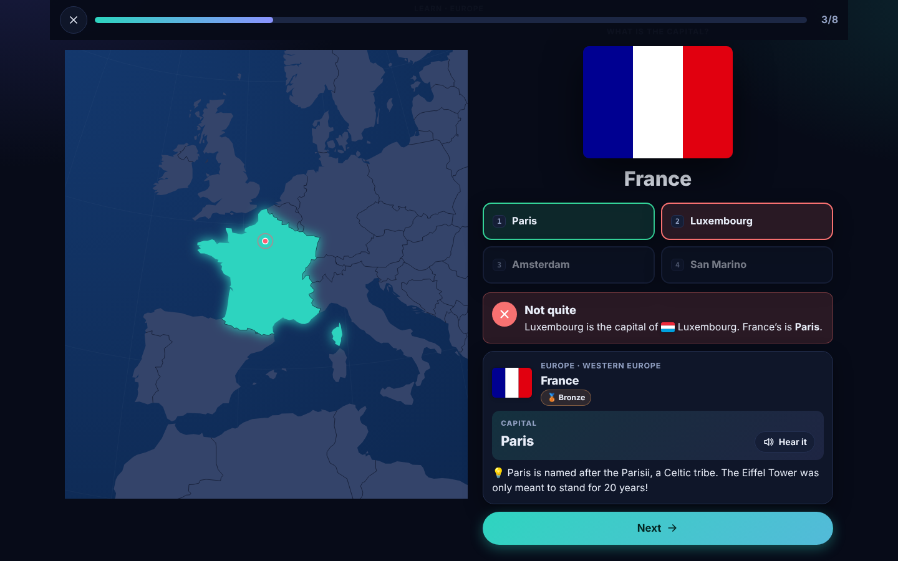
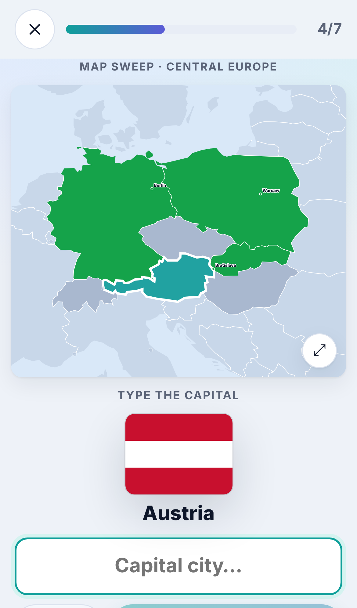
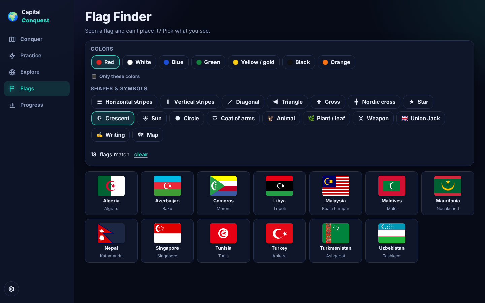

# 🌍 Capital Conquest

A fast, highly visual game for memorizing the capitals of **all 197 countries** (193 UN members + Vatican City, Palestine, Kosovo and Taiwan). Built for a player who already knows every flag: the flags become the memory hooks for the capitals.

**Play:** https://sabhirud.github.io/country-capital-game/ (once GitHub Pages is switched on; see [Deploying](#deploying)).

Works on laptop and phone. Add it to the phone's home screen and it behaves like an app and works offline.

<p>
  
  
</p>
<p>
  
  
</p>

---

## How to play

| Screen | What it does |
|---|---|
| **Conquer** | Your world map. Countries turn 🥉 bronze → 🥈 silver → 🥇 gold as you master their capitals. Pick a focus (whole world, a continent, or a sub-region like *Balkans* or *Caribbean*) and press **Continue**. |
| **Learn** (the Continue button) | A short session: today's due reviews plus up to 5 new countries. New countries start with a study card (flag, capital, pronunciation, memory hook, and a 3D globe that flies there), then a quiz. |
| **Practice** | Free play: Flag → Capital, Country → Capital, Capital → Country, Capital → Flag, **Map Pin** (tap the country), **Map Sweep** (name every capital in a region as the map fills in), **Trick Capitals** (Sydney? Istanbul? Lagos?) and **Weak Spots**. |
| **Explore** | Search any country or capital (typo-tolerant), spin the globe, browse flags by continent. |
| **Flags** | Flag Finder: pick colors and symbols (red + crescent, Nordic cross, eagle…) to identify a flag. |
| **Progress** | Conquest by continent, upcoming reviews, activity, toughest capitals. |

Keyboard (laptop): **1–4** to pick an answer, **Enter** to submit or go to the next question, **H** for a hint, **Esc** to leave a session.

## The learning science behind it

- **Spaced repetition.** Each capital returns just before you'd forget it: same session → ~1 day → 2–3 days → 6 → 14 → 30.
- **Active recall, with difficulty that grows.** New capitals start as multiple choice (recognition). Once they stick, you type them from memory (recall). Wrong options are smart: neighbors, famous "decoy" cities (Sydney for Australia), and capitals you've confused before.
- **Gold can't be crammed.** Recognition answers can only earn bronze, and gold needs correct typed recall on different days. Countries overdue for review look *faded* on the map.
- **Dual coding.** Flag + map location + name + spoken pronunciation give several routes back to the same memory.
- **Chunking & interleaving.** New capitals arrive a few at a time from one sub-region (3–11 countries each), mixed in with reviews from elsewhere.
- **Elaboration & error correction.** Every capital has a memory hook. Mistakes are explained ("Kingston is Jamaica's capital; St Vincent's is Kingstown"), and you retype the right answer once to lock it in.

Answers forgive accents, capitalization and small typos (Bogota = Bogotá, Kiev = Kyiv). Countries with more than one official capital accept all of them and explain the split (Bolivia, South Africa, Netherlands, Côte d'Ivoire, Benin, Sri Lanka, Malaysia, Eswatini, Burundi, Montenegro, Yemen, Chile, Palestine).

## Progress & privacy

There are no accounts and no server. Progress is stored in the browser on each device. **Settings → Download backup / Restore backup** moves or saves it. On iPhone, add the game to the Home Screen (Share → Add to Home Screen) so Safari never clears its data.

## Development

```bash
npm install
npm run dev        # http://localhost:5173/country-capital-game/
npm test           # data-integrity + engine tests (vitest)
npm run build      # type-check + production build into dist/
npm run e2e        # browser smoke test (needs `npx vite preview --port 4173` running and Playwright installed)
```

Requires Node 22.18+ (the build script imports the TypeScript country data directly).

```
src/data/countries/*.ts   197 countries: capital(s), coordinates, sub-region, memory hook, pronunciation, flag tags
src/data/trickCapitals.ts famous non-capital "decoy" cities
src/engine/               spaced repetition, answer checking, wrong-answer generation, session builder, search, storage
src/map/                  Globe (canvas, orthographic) and FlatMap (SVG, Equal Earth, pan/zoom)
src/components/quiz/      the quiz flow and summary
src/screens/              Conquer, Learn, Practice, Explore, Flag Finder, Progress, Settings
scripts/build-geo.mjs     slims Natural Earth map data to the 197 countries and copies their flags
tests/                    data checks (e.g. every capital lies inside its own country) and engine tests
e2e/smoke.cjs             plays real sessions at phone and laptop sizes and saves screenshots
```

## Deploying

A GitHub Actions workflow (`.github/workflows/deploy.yml`) tests, builds and publishes the site on every push to `main`. One-time setup: in the repository, **Settings → Pages → Build and deployment → Source: GitHub Actions**.

## Credits

- Map data: [Natural Earth](https://www.naturalearthdata.com/) via [world-atlas](https://github.com/topojson/world-atlas) (public domain).
- Flags: [flag-icons](https://github.com/lipis/flag-icons) (MIT).
- Built with React, Vite, d3-geo and canvas-confetti.
